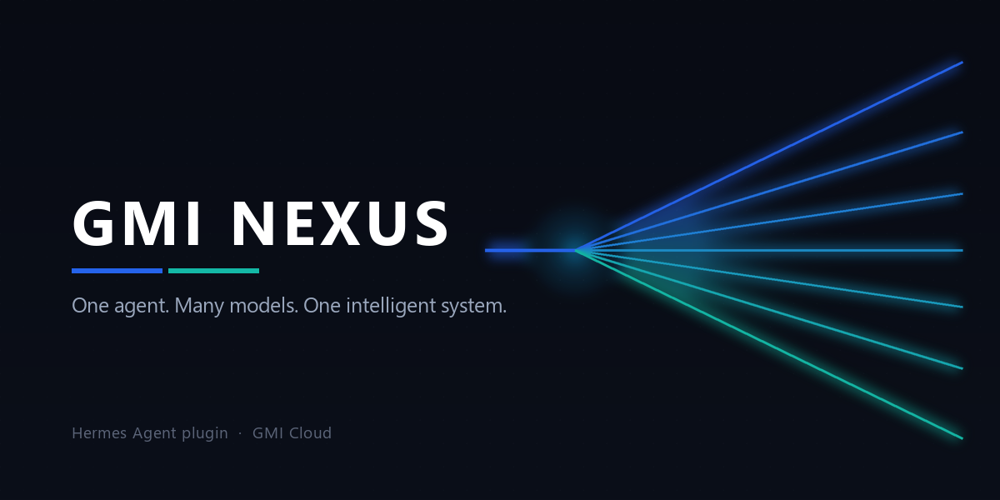
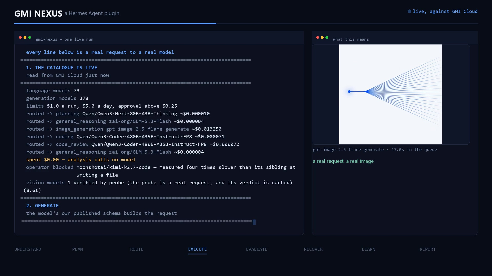
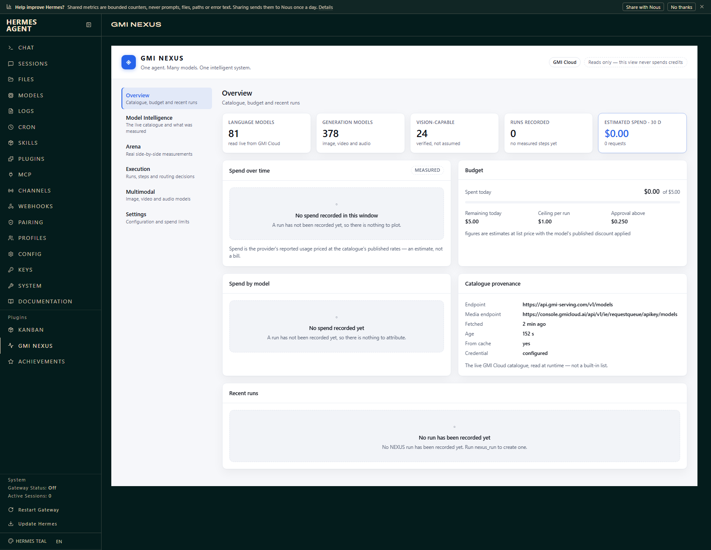
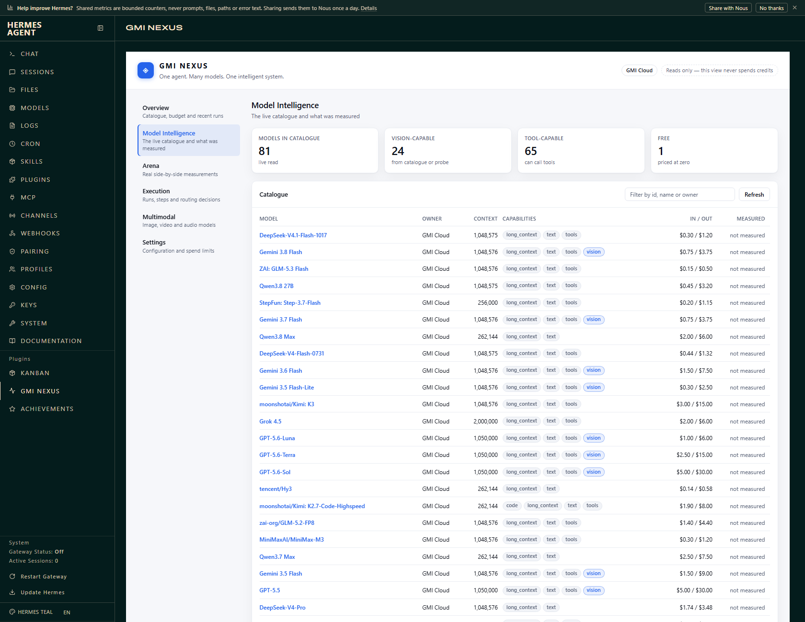
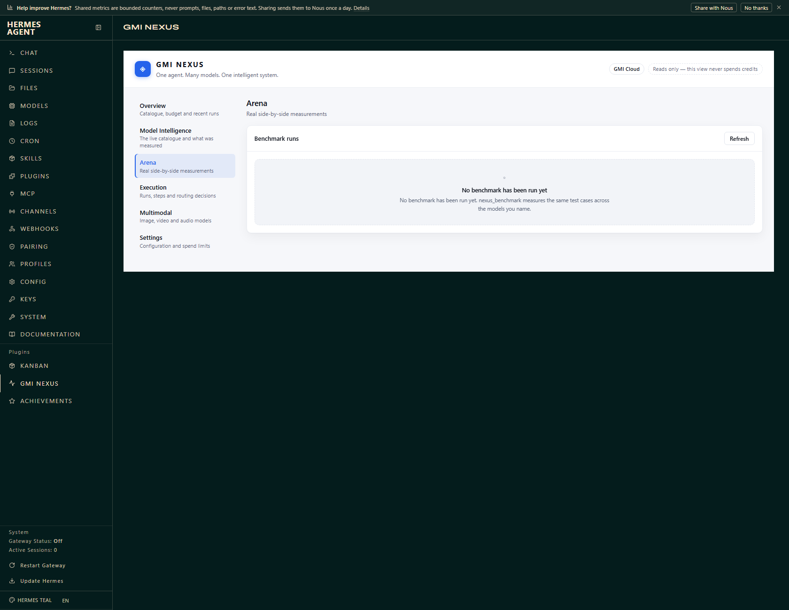
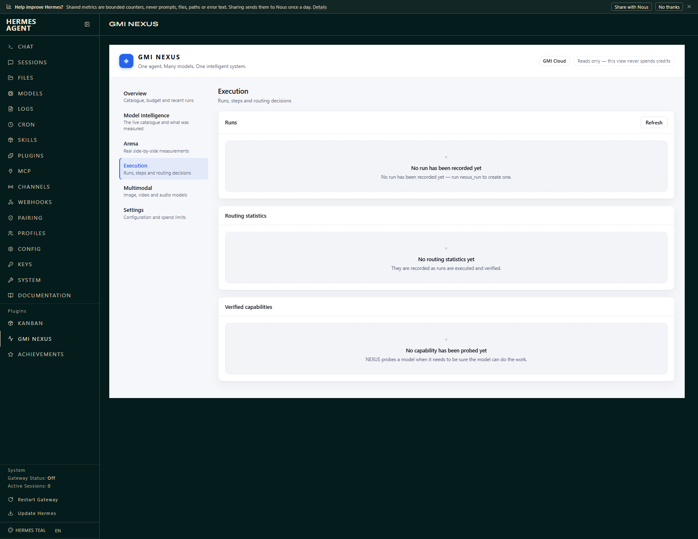
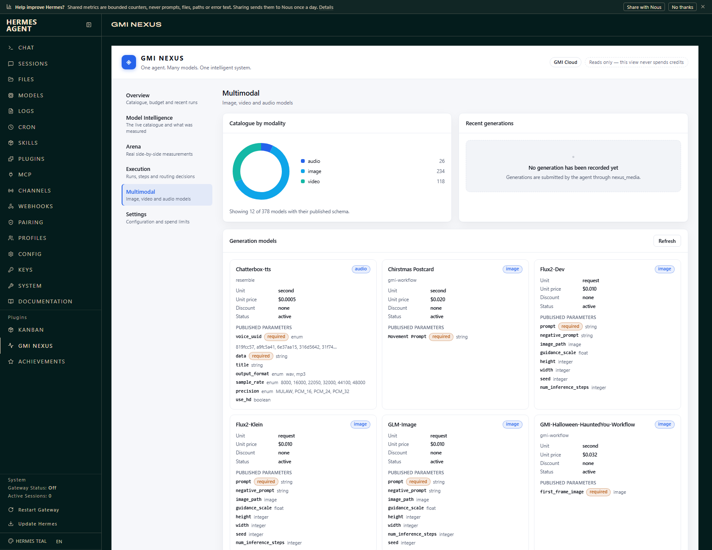
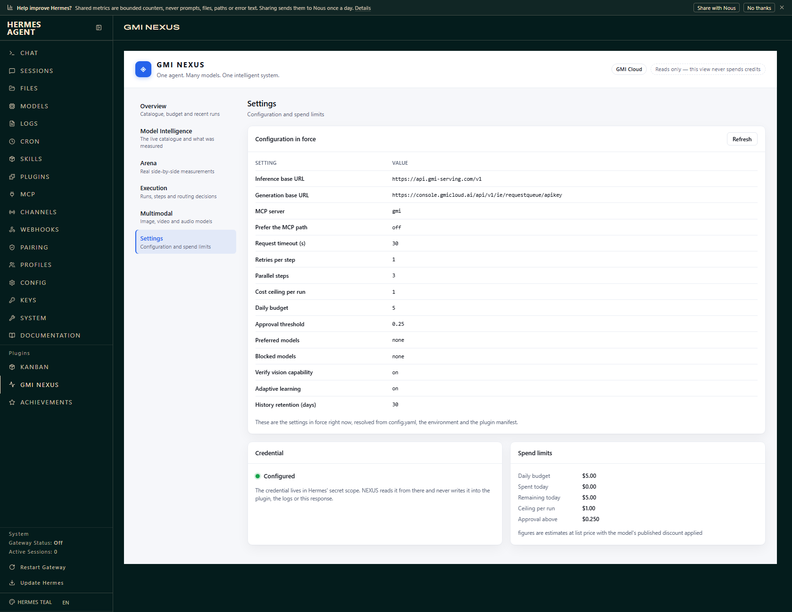

# GMI NEXUS

**One agent. Many models. One intelligent system.**



GMI NEXUS is a [Hermes Agent](https://github.com/NousResearch/hermes-agent)
plugin that turns a single goal into a coordinated multi-model workflow over the
**live GMI Cloud catalogue**. It understands what was asked, plans the work,
routes each step to the model that suits it, runs the steps, checks the
results, recovers from failures, learns from the measured outcome, and reports
what actually happened.

It is not an API wrapper. Every model id it uses is discovered at runtime, so a
model that is retired stops being routable and a model that is added becomes
routable without a code change.

---

## The demo



**[Watch the 80-second demo](docs/demo/gmi-nexus-demo.mp4)** — 1920×1080, with
narration, inside the ninety seconds the brief allows.

It is a **single continuous take**: no cuts, no re-recordings, no
reconstructions. The run behind it took **68.6 seconds**, and the video is
**80.4**. The terminal on the left is that run's own transcript, the numbers
on the right are read out of the run's JSON, the image is the asset GMI
generated during that run, and the landing page is the file the Dev Agent
wrote and tested during that run — including the RECOVER, where a model the
provider had retired is refused and the work moves to a different one.

Every number in it was measured by that run. Nothing in it was drawn by hand,
and the narration is checked against that run's own JSON before it is
synthesised and again before the video is cut — so the voice cannot describe
a run that did not happen.

---

## Repository layout

This repository holds the plugin and the tooling that develops it. They are
kept apart on purpose: the catalog clones the pinned commit and installs the
plugin **directory**, so development tooling must not travel inside it.

| Path | What it is |
| --- | --- |
| [`plugins/gmi-nexus/`](plugins/gmi-nexus/) | **The plugin.** This is what Hermes installs. |
| [`plugins/gmi-nexus/README.md`](plugins/gmi-nexus/README.md) | The plugin's own documentation — the page the Hermes catalog renders. |
| [`plugins/gmi-nexus/docs/`](plugins/gmi-nexus/docs/) | Architecture, setup and API reference. |
| [`docs/screenshots/`](docs/screenshots/) | The dashboard, photographed in a real browser against a real Hermes install. |
| [`docs/banner.png`](docs/banner.png) | The catalogue card's banner, drawn by [`scripts/make_banner.py`](scripts/make_banner.py). |
| [`tests/`](tests/) | The test suite. Runs against the plugin package as shipped. |
| [`scripts/demo_run.py`](scripts/demo_run.py) | The demo scenario, end to end — free in `--dry-run`, real in `--live`. |
| [`scripts/demo_video.py`](scripts/demo_video.py) | The short live run the demo video records — five phases, under ninety seconds. |
| [`scripts/validate_installation.py`](scripts/validate_installation.py) | Loads the plugin the way Hermes loads it and proves the contract holds. |
| [`scripts/make_banner.py`](scripts/make_banner.py) | Draws the banner. A development tool — it needs Pillow, which the plugin itself does not. |
| [`scripts/probes/`](scripts/probes/) | The one-off scripts that found seven of the ten defects the mocked tests could not. Not part of the plugin; each one is documented in [its README](scripts/probes/README.md). |
| [`BUILD_STATUS.md`](BUILD_STATUS.md) | What is done, what is not, and what was tested. |

---

## The eight-step adaptive pipeline

| Step | What happens |
| --- | --- |
| **UNDERSTAND** | The goal is classified into a task type, and the capabilities the work requires are worked out. |
| **PLAN** | The goal is broken into steps, each with its own task type and requirements. |
| **ROUTE** | Every step is scored against the live catalogue. Models that lack a required capability are ruled out; the rest are ranked by quality, reliability, latency, cost and measured history. |
| **EXECUTE** | The steps run, up to three at a time. Each call is accounted for. |
| **EVALUATE** | Every result is checked against the step's own criteria — not merely "did it return something". |
| **RECOVER** | A step that fails is retried, on a different model, with the failure attached to the prompt. Retries are bounded and the models already tried are never tried again. |
| **LEARN** | The verified outcome — success, latency, cost — is folded into the routing statistics, which change how later steps are scored. |
| **REPORT** | What was planned, which models ran it, what it cost and what failed is returned to Hermes in one structured report. |

> **Adaptive learning here means better routing, not a retrained model.** NEXUS
> never modifies a foundation model's weights. It measures which model handled
> which kind of work, how reliably, how quickly and at what cost — and uses that
> to route better next time.

---

## The eight tools

| Tool | What it does |
| --- | --- |
| `nexus_models` | Lists what GMI Cloud actually offers right now, with the capabilities NEXUS has *verified* for each one and their published prices. |
| `nexus_analyze` | Understands a goal, breaks it into steps and shows which model each step would route to — without calling a model and without spending anything. |
| `nexus_run` | Runs a goal through the whole pipeline. |
| `nexus_benchmark` | Runs identical test cases across several models and reports quality, correctness, latency, token use, cost and reliability. The scores come from real requests. |
| `nexus_vision` | Looks at images: answers questions, lists the concrete defects in a screenshot or mockup, compares a before and an after. |
| `nexus_media` | Generates images, video and audio, and edits existing images including masked edits. |
| `nexus_dev` | Implements a code change with a GMI model, writes the files through Hermes' own `write_file` tool, runs the tests through Hermes' `terminal` tool, reads the failure and fixes it. |
| `nexus_report` | Reports what NEXUS has actually done: runs, measured costs and latencies, spend by model, benchmark history, routing statistics. |

The `/nexus` slash command shows the same status without a tool call.

---

## What it refuses to do

These are the rules the code is built around, not promises in a readme.

* **No hard-coded model ids.** The catalogue is read live from
  `GET /v1/models` and the generation catalogue from
  `GET /apikey/models`.
* **No assumed vision.** A language model is never routed to an image task
  because its name looks promising. Vision capability comes from the
  catalogue's own metadata or from a probe that demonstrates the model can
  actually read an image.
* **No reused parameters.** Each generation model publishes its own schema
  (`GET /apikey/models/{id}`). That schema decides the request body. NEXUS
  never sends one model's parameters to another.
* **No false claims of success.** If the API request failed, the tool returns
  the error and the run is recorded as failed. If a generation returns no
  asset, NEXUS says so rather than reporting a success.
* **No estimates presented as bills.** Every figure is the provider's reported
  usage priced at the catalogue's published rates, labelled as an estimate.
* **No parallel shell.** The Dev Agent writes and runs code through Hermes'
  own tools, so Hermes' approval policy, sandboxing and audit trail apply
  exactly as they apply to the agent. NEXUS does not spawn a second execution
  environment.
* **No unbounded spending.** A per-run ceiling, a rolling daily ceiling and an
  approval threshold are enforced before a request is submitted.
* **No secrets in the plugin.** The GMI Cloud key is read through Hermes' secret
  scope. It is never written into the plugin directory, never logged and never
  included in a dashboard response.

---

## Install

```bash
hermes plugins install ./plugins/gmi-nexus
hermes plugins validate ./plugins/gmi-nexus --install-deps
```

Then put your GMI Cloud key where Hermes keeps secrets. A bare `UPPER_SNAKE`
key is written to the profile's `.env`, not to `config.yaml`:

```bash
hermes config set GMI_API_KEY "your-key"
hermes config env-path      # where that .env lives
```

Full instructions, including the catalogue-endpoint checks and the dashboard
setup, are in [`plugins/gmi-nexus/docs/SETUP.md`](plugins/gmi-nexus/docs/SETUP.md).

---

## The dashboard

NEXUS ships a Hermes Web dashboard tab — six sections: **Overview**,
**Model Intelligence**, **Arena**, **Execution**, **Multimodal** and
**Settings**. It reads the live catalogue and the recorded history, and shows
nothing it has not measured.

Where there is no data, the section says so and says why. An estimate is
labelled as an estimate. The credential is reported as configured or not, never
as a value.

These are photographs of the tab running inside a real Hermes install, with the
live GMI Cloud catalogue behind it — not mock-ups.

| Overview | Model Intelligence |
| --- | --- |
|  |  |

| Arena | Execution |
| --- | --- |
|  |  |

| Multimodal | Settings |
| --- | --- |
|  |  |

The Overview shot is the honest state of a fresh install: 81 language models
and 378 generation models read live from GMI Cloud, 24 of them vision-capable,
and zero runs — so the spend charts are empty and say why. It never shows a
number NEXUS did not measure.

See [`plugins/gmi-nexus/docs/API.md`](plugins/gmi-nexus/docs/API.md#the-dashboard-api)
for the routes it serves.

---

## Development

```bash
python -m pytest tests/                       # unit and mocked tests
python scripts/validate_installation.py       # load it the way Hermes does
python scripts/demo_run.py --dry-run          # the demo scenario, end to end
```

The default test run never reaches the network and never spends anything. The
live tests are skipped unless both a credential and an explicit opt-in flag are
present — see
[`plugins/gmi-nexus/docs/HERMES_VALIDATION.md`](plugins/gmi-nexus/docs/HERMES_VALIDATION.md#the-live-tests).

### The demo

`scripts/demo_run.py` runs the whole scenario from the brief as one
continuous run: analyse, break down, select models, generate a visual asset,
implement the page through Hermes' tools, inspect it with a vision model,
correct what the inspection found, verify, and print the report.

```bash
python scripts/demo_run.py --dry-run     # no network, no credential, no money
```

In `--dry-run` mode GMI Cloud is replaced by a scripted stand-in that answers
the same endpoints with the same shapes, so the *orchestration* is real — the
router really scores the catalogue, the budget really refuses an over-limit
request, the Dev Agent really writes a file to disk and really runs its test
against it — while the *outputs* are simulated and labelled `simulated` in the
transcript the script writes. A dry run can never be mistaken for a live one.

```bash
GMI_API_KEY=<key> python scripts/demo_run.py --live --approve-spend
```

`--live` makes the real calls. It refuses to start without both a credential
and `--approve-spend`, it prints what it is about to spend before it spends
it, and it does not raise the plugin's own limits.

It has been run end to end against the real service, six times. That is how
ten defects surfaced which the mocked tests could not find — among them a
catalogue model that answered `"456"` for a number it had never seen, a code
model whose replies came back cut off mid-JSON because the token budget was
too small for a source file, a reported generation latency of 0.4
seconds for a generation that had really taken half a minute, a rejected
API key that was reported as an empty catalogue rather than as a rejected
key, and a model the provider had already retired that the router kept
choosing because the provider's real reason was swallowed. All ten are fixed,
and all ten have regression tests. The whole live exercise cost **just over
$1** of the project's $10 ceiling;
[`BUILD_STATUS.md`](BUILD_STATUS.md) accounts for every figure.

### The short run, for recording

The full scenario takes about four minutes against the real service, so it
cannot be recorded uncut inside a ninety-second video. `scripts/demo_video.py`
is the same plugin on the same real service in five phases — the catalogue, a
generation, a vision inspection, an implementation through Hermes' tools, and
the report — arranged so the whole thing finishes in time to record straight
through. Measured runs come in at **53.4, 76.0 and 82.2 seconds** — the last
one on a cold probe cache, where the vision model is probed live — and every
one of them is inside the ninety-second limit a demo video is allowed.

**It has been recorded.** The cut is at
[`docs/demo/gmi-nexus-demo.mp4`](docs/demo/gmi-nexus-demo.mp4) — 80.4 seconds,
1920×1080, narrated, with every number on screen read out of the run that
produced it.

```bash
GMI_API_KEY=<key> python scripts/demo_video.py --approve-spend --home demo_output/video_home
```

Two things make the difference between a four-minute run and a short one, and
both are the plugin working as designed rather than anything being edited out
of the recording. The **capability probe is cached** — verifying that a model
can really read an image is a real request, so its verdict is recorded in the
plugin's own persistent data directory and reused, which means passing the
same `--home` twice starts the second run with the verdicts already in place.
And the **operator chooses the code model**: the catalogue publishes each
model's price and context length but not its speed, so
[`scripts/probes/probe_code_speed.py`](scripts/probes/probe_code_speed.py)
measured them, and the script blocks the slow one through the plugin's own
`blocked_models` setting. If that model is ever retired the block stops
matching anything and the router falls back to the catalogue on its own.

The image generation is the phase the video cannot do without, and the
catalogue publishes nothing about how long it takes, so
[`scripts/probes/probe_image_speed.py`](scripts/probes/probe_image_speed.py)
measured it: the two cheapest image models in the catalogue waited in the
request queue for four minutes and were never dispatched, while the models
that did run took between 14.5 and 21.3 seconds in six cases out of seven.

The dashboard's tests substitute a stand-in router when the installed
`fastapi` and `starlette` disagree, which is an environment fault that breaks
Hermes' own dashboard too. Running the suite under Hermes' declared pins
exercises the real router instead:

```bash
python -m venv .venv && .venv/Scripts/python -m pip install \
    "fastapi==0.133.1" "uvicorn==0.54.0" "starlette==1.9.0" "python-multipart==0.0.32" pytest
.venv/Scripts/python -m pytest tests/       # 230 passed, 5 skipped
```

That run was last recorded at 230 passed and 5 skipped, before the suite grew
by the tests for the generation-latency fix, the retired-model verdict and the
malformed-JSON repair. On the system interpreter the same suite is now **244
passed, 6 skipped**; under these pins the sixth skip does not happen, because
the real `fastapi` router loads.

That changes nothing about the machine you run it on — the pins live in the
virtual environment and shadow whatever the system interpreter has. If you
also want to run *Hermes' own dashboard server* from that environment, create
it with `--system-site-packages` so it can still see the rest of Hermes'
dependencies:

```bash
python -m venv --system-site-packages .venv
```

Either way the system interpreter is left alone.

## Licence

Apache-2.0.
