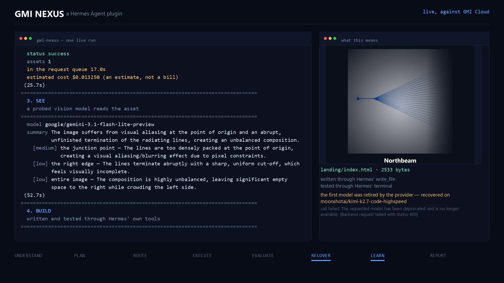
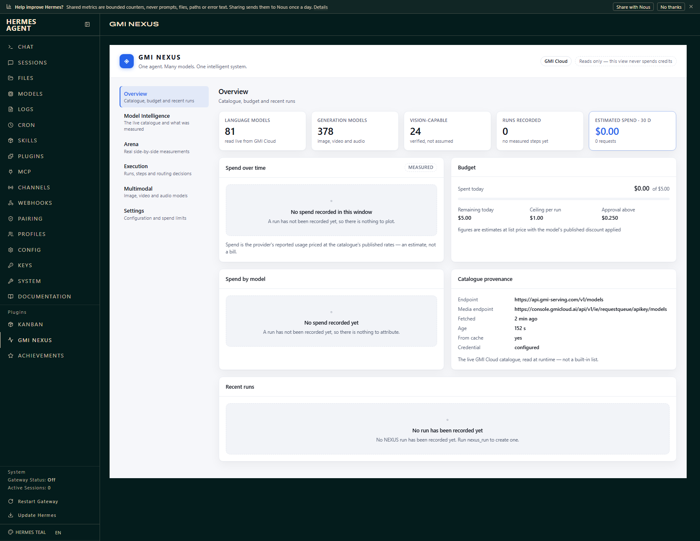
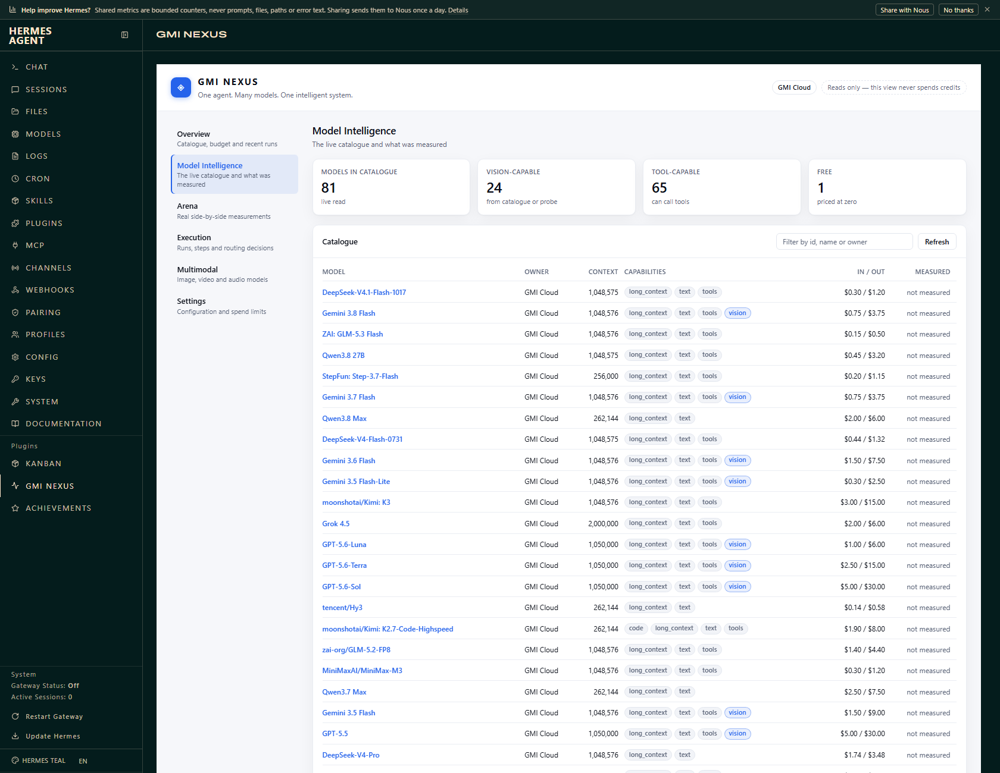
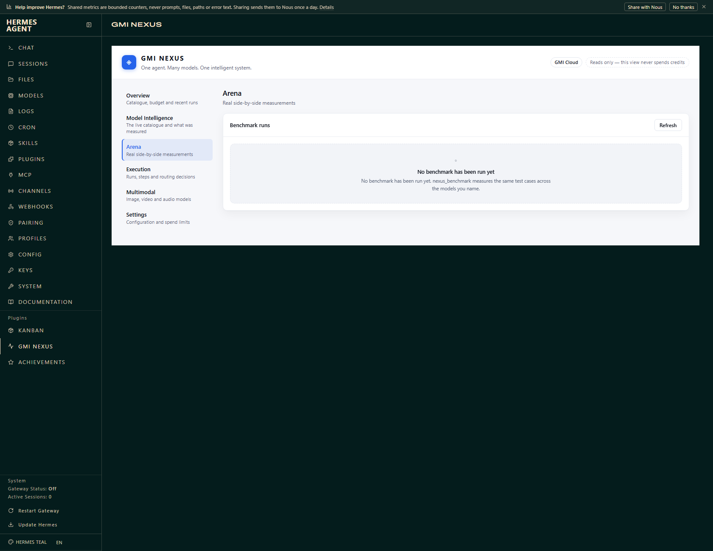
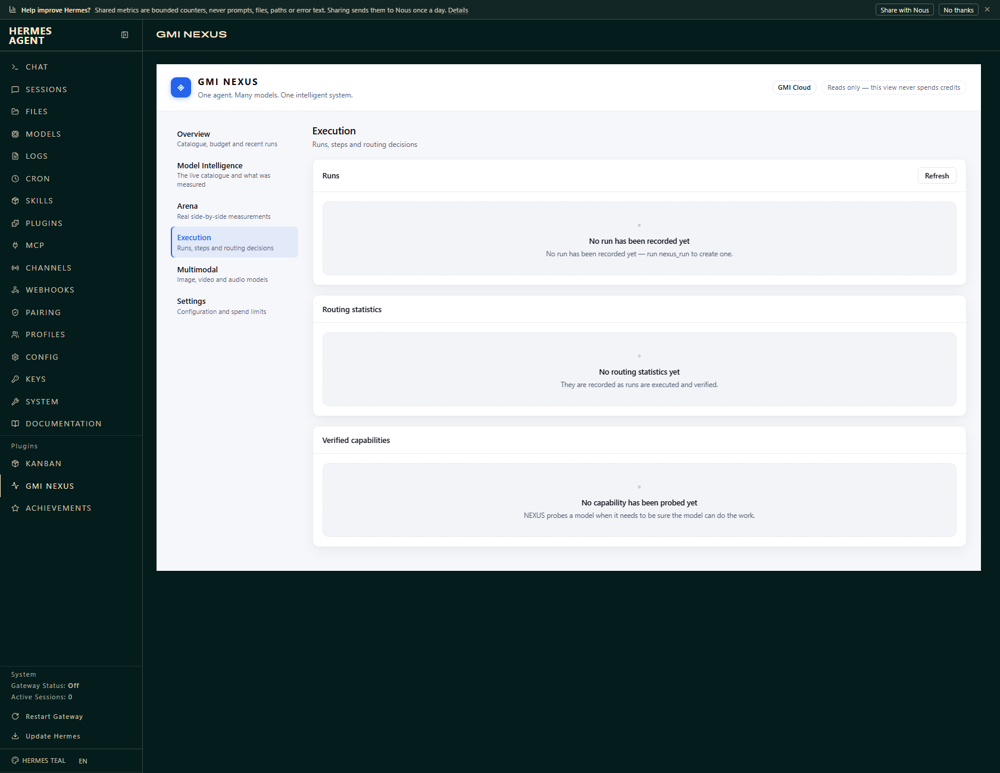
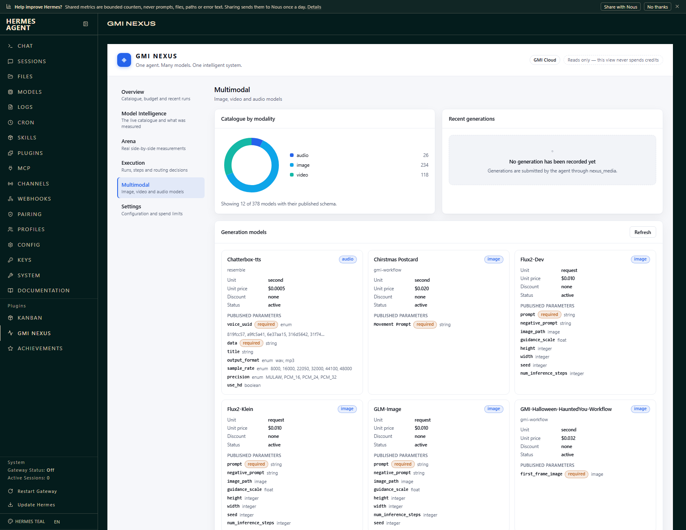
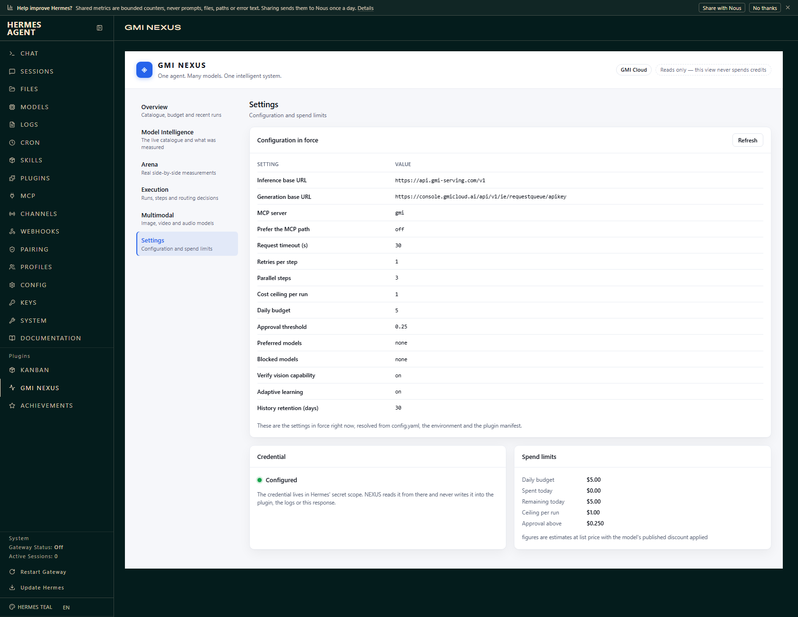

# GMI NEXUS

**One agent. Many models. One intelligent system.**

GMI NEXUS is a Hermes Agent plugin that turns a single goal into a coordinated
multi-model workflow over the **live GMI Cloud catalogue**. It understands what
was asked, plans the work, routes each step to the model that suits it, runs
the steps, checks the results, recovers from failures, learns from the measured
outcome, and reports what actually happened.

It is not an API wrapper. Every model id it uses is discovered at runtime, so a
model that is retired stops being routable and a model that is added becomes
routable without a code change.

---

## Verified against the real service

Not against a mock. The plugin has been run against GMI Cloud itself — real
inference, real vision, real image generation, and real code written and
tested through Hermes' own tools.

That is how **ten defects** surfaced which mocked tests could not find. Among
them: a catalogue model that answered `"456"` for a number it had never seen,
which passed a capability probe written in a way that could be answered by
luck; a code model whose replies came back cut off mid-JSON because the
token budget was too small for a source file, so the error blamed the model
when the request was at fault; a reported generation latency of 0.4
seconds for a generation that had really taken half a minute, because the
clock started after the queue had already done the work; and a rejected API
key that was reported as an empty catalogue rather than as a rejected key.
All ten are fixed and all ten have regression tests. The whole live
exercise cost **just over $1** of the project's $10 ceiling.

The last two came out of the final recorded run. GMI Cloud's catalogue still
listed a code model the provider had already retired, so the router chose it,
called it, and was refused with *"Backend request failed with status 400"* —
the real reason, *"The requested model has been deprecated and is no longer
available."*, was nested one level down and never reached the caller. NEXUS now
reads the provider's own reason out of the error, reports it verbatim, and
**remembers the verdict**: a model the provider has retired is not routed to
again, and the run recovers on a different one. And a code reply that was
*right* but wrote the newlines inside its JSON string literally was thrown away
as unparseable; the parser now repairs that case rather than discarding good
work, and the retry shows the model the reply that failed instead of asking the
same bounded question again.

[`docs/HERMES_VALIDATION.md`](docs/HERMES_VALIDATION.md) keeps four levels of
verification apart — unit, mocked integration, live API, and a load inside a
real Hermes install — and states plainly what has **not** been verified.

---

## The demo



**[Watch the 80-second demo](../../docs/demo/gmi-nexus-demo.mp4)** — 1920×1080,
with narration.

Every number in it came out of one real run against GMI Cloud, and nothing in
it was drawn by hand. The terminal on the left is the run's own transcript, the
numbers on the right are read out of the run's JSON, the image is the asset
GMI generated during that run, and the landing page is the file the Dev Agent
wrote and tested during that run — including the RECOVER, where a model the
provider had retired is refused and the work moves to a different one.

The video is a single continuous take: no cuts, no re-recordings, no
reconstructions. The run behind it took **68.6 seconds**, and the video is
**80.4**.

---

## The eight-step adaptive pipeline

| Step | What happens |
| --- | --- |
| **UNDERSTAND** | The goal is classified into a task type, and the capabilities the work requires are worked out. |
| **PLAN** | The goal is broken into steps, each with its own task type and requirements. |
| **ROUTE** | Every step is scored against the live catalogue. Models that lack a required capability are ruled out; the rest are ranked by quality, reliability, latency, cost and measured history. |
| **EXECUTE** | The steps run, up to three at a time. Each call is accounted for. |
| **EVALUATE** | Every result is checked against the step's own criteria — not merely "did it return something". |
| **RECOVER** | A step that fails is retried, on a different model, with the failure attached to the prompt. Retries are bounded and the models already tried are never tried again. |
| **LEARN** | The verified outcome — success, latency, cost — is folded into the routing statistics, which change how later steps are scored. |
| **REPORT** | What was planned, which models ran it, what it cost and what failed is returned to Hermes in one structured report. |

> **Adaptive learning here means better routing, not a retrained model.** NEXUS
> never modifies a foundation model's weights. It measures which model handled
> which kind of work, how reliably, how quickly and at what cost — and uses that
> to route better next time.

---

## The eight tools

| Tool | What it does |
| --- | --- |
| `nexus_models` | Lists what GMI Cloud actually offers right now, with the capabilities NEXUS has *verified* for each one and their published prices. |
| `nexus_analyze` | Understands a goal, breaks it into steps and shows which model each step would route to — without calling a model and without spending anything. |
| `nexus_run` | Runs a goal through the whole pipeline. |
| `nexus_benchmark` | Runs identical test cases across several models and reports quality, correctness, latency, token use, cost and reliability. The scores come from real requests. |
| `nexus_vision` | Looks at images: answers questions, lists the concrete defects in a screenshot or mockup, compares a before and an after. |
| `nexus_media` | Generates images, video and audio, and edits existing images including masked edits. |
| `nexus_dev` | Implements a code change with a GMI model, writes the files through Hermes' own `write_file` tool, runs the tests through Hermes' `terminal` tool, reads the failure and fixes it. |
| `nexus_report` | Reports what NEXUS has actually done: runs, measured costs and latencies, spend by model, benchmark history, routing statistics. |

The `/nexus` slash command shows the same status without a tool call.

---

## What it refuses to do

These are the rules the code is built around, not promises in a readme.

* **No hard-coded model ids.** The catalogue is read live from
  `GET /v1/models` and the generation catalogue from
  `GET /apikey/models`.
* **No model the provider has retired.** GMI Cloud publishes the catalogue
  and the models it can actually serve separately, so a retired model can keep
  its place in the catalogue. When the provider refuses one, NEXUS reads the
  provider's *own* reason out of the error, reports it verbatim instead of a
  generic "backend request failed", and remembers the verdict — the model is
  not routed to again, and the work moves to a different one.
* **No assumed vision.** A language model is never routed to an image task
  because its name looks promising. Vision capability comes from the
  catalogue's own metadata or from a probe that demonstrates the model can
  actually read an image — a probe that draws a **random three-digit
  number** and asks the model to read it back, because a probe that can be
  answered by luck proves nothing.
* **No reused parameters.** Each generation model publishes its own schema
  (`GET /apikey/models/{id}`). That schema decides the request body. NEXUS
  never sends one model's parameters to another.
* **No false claims of success.** If the API request failed, the tool returns
  the error and the run is recorded as failed. If a generation returns no
  asset, NEXUS says so rather than reporting a success. If a reply was cut
  off by the token limit, NEXUS says *that* rather than blaming the model.
* **No estimates presented as bills.** Every figure is the provider's reported
  usage priced at the catalogue's published rates, labelled as an estimate.
* **No parallel shell.** The Dev Agent writes and runs code through Hermes'
  own tools, so Hermes' approval policy, sandboxing and audit trail apply
  exactly as they apply to the agent. NEXUS does not spawn a second execution
  environment.
* **No unbounded spending.** A per-run ceiling, a rolling daily ceiling and an
  approval threshold are enforced before a request is submitted — including
  by the Dev Agent. The model cannot approve its own spend: a call that
  reaches the threshold is held for a person through Hermes' own approval
  prompt, and a call whose cost cannot be worked out is always held.
* **No secrets in the plugin.** The GMI Cloud key is read through Hermes' secret
  scope. It is never written into the plugin directory, never logged and never
  included in a dashboard response.
* **No unchecked paths or URLs.** A local file the model names is resolved and
  checked by extension *and* by its bytes before it is read, and is never read
  from inside Hermes' home directory. A remote URL the model names is resolved
  and checked on every redirect hop, and an internal address is refused.

---

## Disclosure

What a user should know before installing.

* **Calls a third-party service.** NEXUS talks to GMI Cloud: the
  OpenAI-compatible inference endpoint `https://api.gmi-serving.com/v1` and the
  generation request queue
  `https://console.gmicloud.ai/api/v1/ie/requestqueue/apikey`. Model catalogues
  are read from these; prompts, images and other inputs are sent to them when
  the agent asks NEXUS to do a task.
* **Stores one credential.** `GMI_API_KEY`, declared `secret: true`. Hermes
  keeps it in the profile's `.env` and NEXUS reads it through Hermes' secret
  scope, so it follows the active profile and is never written into the plugin
  directory, logged, or returned by the dashboard — which reports only whether
  a key is configured.
* **Reads and writes outside the plugin's own data.** The Dev Agent works in
  the directory the agent is in, and it does so **through Hermes' own tools**
  (`write_file`, `terminal`), so Hermes' approval policy, sandboxing and audit
  trail apply exactly as they apply to the agent. NEXUS spawns no shell of its
  own.
* **Starts no background process.** No threads, no daemons, no services.
* **Sends no telemetry.** Nothing is sent anywhere except GMI Cloud, and only
  as part of a request the agent asked for.
* **Spends money, within limits.** A per-run ceiling, a rolling daily ceiling
  and an approval threshold are enforced *before* a request is submitted. A
  request estimated at or above the threshold is **held for a person**: NEXUS
  hands it to Hermes' own approval prompt, and only the person answering that
  prompt unlocks it. There is no `approve` argument in any of NEXUS' tool
  schemas, and no way for the model to approve its own spend — the approval
  rule is per tool, so allowing one tool does not allow another. A request
  whose cost cannot be worked out — because the catalogue publishes no price
  for the model — is always held; an unknown cost is never treated as a zero
  cost. The figures NEXUS reports are the provider's reported usage priced at
  the catalogue's published rates, and they are labelled as estimates — never
  as a bill.
* **Reads local files the model names.** `nexus_media` and `nexus_vision` take
  an image or a mask, and a model can put a path in either. NEXUS checks the
  path before opening it: the path is resolved (so a symlink is followed to
  where it really points), the file must be a regular file, its extension must
  name an image type **and** its first bytes must be that image type, and it
  must live in the working directory, NEXUS' own plugin-data directory or the
  system temporary directory. A file inside Hermes' home directory — where the
  profile's `.env` and every other secret lives — is never read and never
  sent. A file that fails any of these checks is refused, and nothing is
  uploaded.
* **Fetches remote images the model names.** To inline an image, NEXUS
  downloads it, and the URL came from a model, so it is checked rather than
  trusted: every hop of the redirect chain is resolved, and every address must
  be a public one. Private, loopback, link-local, reserved and multicast
  addresses are refused — `169.254.169.254` among them — as is a host that
  cannot be resolved at all. The image type comes from the bytes, not from the
  server's `Content-Type`. A refused URL is a refusal, not a failed download:
  NEXUS does not fall back on sending it along.
* **May send a probe image.** To verify that a model can actually read an
  image, NEXUS may send it a small probe picture — a randomly drawn
  three-digit number — and ask it to read the number back. That is a real
  request and is accounted for like any other.

---

## Install

```bash
hermes plugins install ./plugins/gmi-nexus
hermes plugins validate ./plugins/gmi-nexus --install-deps
```

Then put your GMI Cloud key where Hermes keeps secrets. A bare `UPPER_SNAKE`
key is written to the profile's `.env`, not to `config.yaml`:

```bash
hermes config set GMI_API_KEY "your-key"
hermes config env-path      # where that .env lives
```

Full instructions, including the catalogue-endpoint checks and the dashboard
setup, are in [`docs/SETUP.md`](docs/SETUP.md).

---

## The dashboard

NEXUS ships a Hermes Web dashboard tab — six sections: **Overview**,
**Model Intelligence**, **Arena**, **Execution**, **Multimodal** and
**Settings**. It reads the live catalogue and the recorded history, and shows
nothing it has not measured.

Where there is no data, the section says so and says why. An estimate is
labelled as an estimate. The credential is reported as configured or not, never
as a value.

These are photographs of the tab running inside a real Hermes install, with the
live GMI Cloud catalogue behind it — not mock-ups.

| Overview | Model Intelligence |
| --- | --- |
|  |  |

| Arena | Execution |
| --- | --- |
|  |  |

| Multimodal | Settings |
| --- | --- |
|  |  |

The Overview shot is the honest state of a fresh install: the live catalogue
read from GMI Cloud, and no runs — so the spend charts are empty and say why.
It never shows a number NEXUS did not measure.

See [`docs/API.md`](docs/API.md#the-dashboard-api) for the routes it serves.

---

## Documentation

| Document | What is in it |
| --- | --- |
| [`docs/ARCHITECTURE.md`](docs/ARCHITECTURE.md) | How the plugin is put together, module by module, and why. |
| [`docs/SETUP.md`](docs/SETUP.md) | Installing, configuring, and the spend limits. |
| [`docs/API.md`](docs/API.md) | Every tool, its parameters, and the dashboard routes. |
| [`docs/HERMES_VALIDATION.md`](docs/HERMES_VALIDATION.md) | How the plugin was verified inside a real Hermes install. |
| [`BUILD_STATUS.md`](../../BUILD_STATUS.md) | What is done, what is not, and what was tested. |

---

## Development

The tests, the validation script and the development configuration live in the
repository around this directory, not inside it — the catalog installs this
directory, and development tooling must not travel with it.

```bash
python -m pytest tests/                       # unit and mocked tests
python scripts/validate_installation.py       # load it the way Hermes does
GMI_LIVE_TESTS=1 GMI_API_KEY=... pytest tests/test_live.py   # opt-in, costs money
```

The default test run never reaches the network and never spends anything. The
live tests are skipped unless both a credential and an explicit opt-in flag are
present — see [`docs/HERMES_VALIDATION.md`](docs/HERMES_VALIDATION.md#the-live-tests).

## Licence

Apache-2.0.
